<table>
  <tr>
    <td width="200" align="center" valign="middle">
      <a href="https://razmochaev.com">
        <picture>
          <source media="(prefers-color-scheme: dark)" srcset="./assets/avatar-dark.svg" />
          <source media="(prefers-color-scheme: light)" srcset="./assets/avatar-light.svg" />
          
        </picture>
      </a>
    </td>
    <td width="630" valign="middle">
      
<b>Razmochaev</b>

      

        <b>OS</b> · macOS, iOS, Ubuntu 
        iPhone 13 Pro Max · 16.0.2 - Dopamine 
        iPhone 11 · 27.2 - Liter8
      

      

        <b>Kernel</b> · Product &amp; Software Engineer 
        <b>Host</b> · Rheinland-Pfalz, Deutschland 
        <b>Uptime</b> · <!-- UPTIME:START -->22 years, 7 months, 0 days<!-- UPTIME:END --> 
        <b>Contact</b> · ruslanrazmochaev@icloud.com
      

    </td>
  </tr>
</table>

<table>
  <tr>
    <td width="830" align="center" valign="middle">
      <a href="https://razmochaev.com">
        <picture>
          <source media="(prefers-color-scheme: dark)" srcset="./assets/site-link-dark.svg" />
          <source media="(prefers-color-scheme: light)" srcset="./assets/site-link-light.svg" />
          
        </picture>
      </a>
    </td>
  </tr>
</table>
